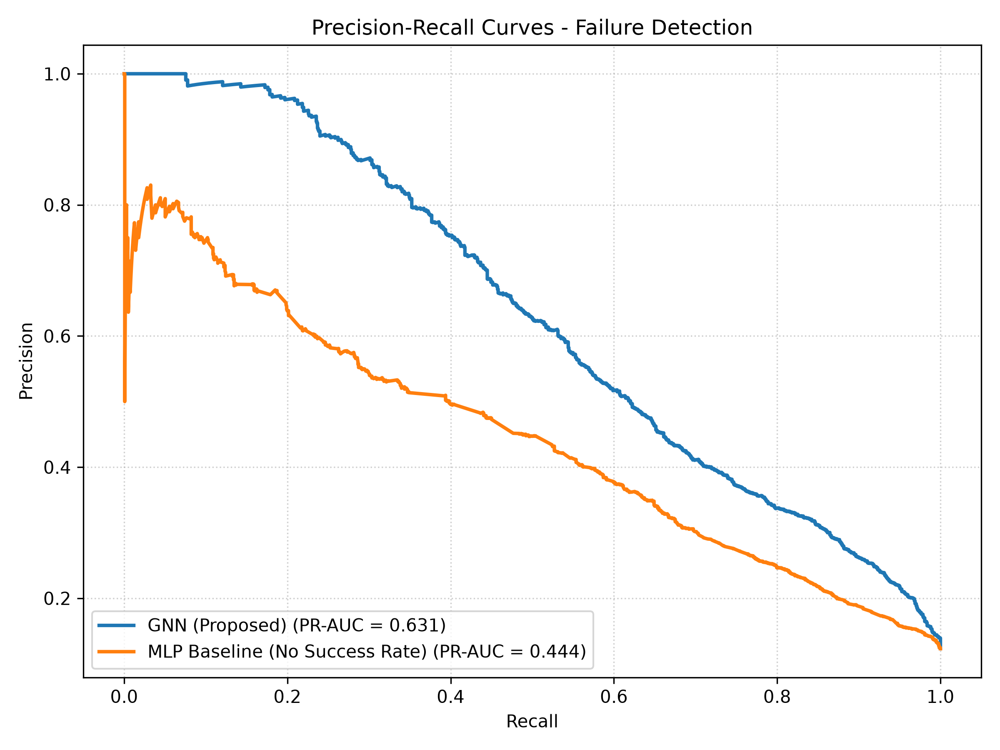
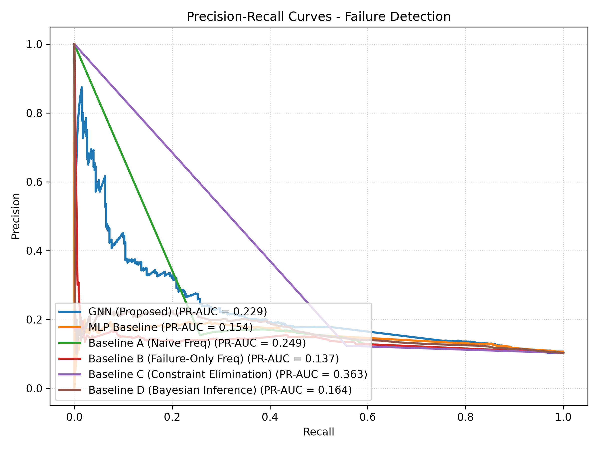
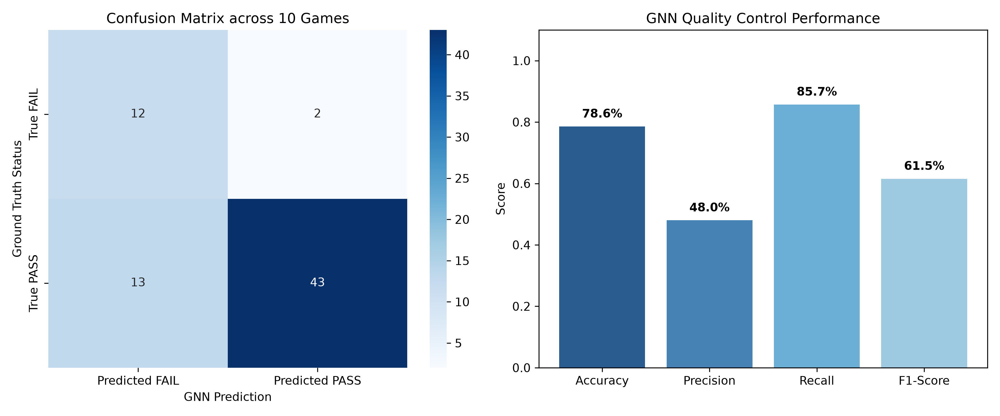

# Can AI Solve Mysteries? 
I developed an LLM-NLP-GNN pipeline that can solve a social deduction game given a transcript of the play phase (before the roles are revealed). This demonstrates an ability to solve root-cause-inference problems, with applications in fields like supply chain management.

[See "AI Mystery Solver" Powerpoint for more information]

## Motivation
There is something inherently interesting about a mystery because it creates a desire to learn through deduction. Mystery novels, films, and role-playing games are very popular entertainment in today's world. But what actually makes a good mystery? The stakes must be compelling (why do we want to know what happens?), and the story must be logically sound. When I tried my hand at writing mysteries, I found that I needed to flesh out the true timeline first, and then figure out how to obscure it and give little clues to drive the plot. My attempts to collaborate with LLMs during the writing phase gave me a thought: if AI can write mysteries, maybe it can also solve them. 

However, I got stuck back at square one: why should people care? What is inherently valuable about AI solving mysteries? Furthermore, is this experiment even worth my time? That's when I realized that a mystery is essentially a root-cause inference problem. I had always thought of entertainment-oriented cause/effect scenarios (solving crimes, for instance), but the same logical process works for any cause/effect scenario. Given my interest in operations research, I set my eyes on supply chain management problems.

## Overview
This project converts a transcript of a social deduction game into an analysis of which inputs to a company's supply chain are responsible for downstream inspection failures. I divided the project into three phases:

**Phase 1:** Use a GNN to solve direct root cause inference problems from graph inputs. 

**Phase 2:** Use NLP models to extract a dictionary of relevant information from a company report to then construct a graph to feed the GNN.

**Phase 3:** Prompt LLMs (ChatGPT, Claude, and Gemini) to summarize social deduction game transcripts as company reports to feed the NLP models.

Together, they make a pipeline that can solve a social deduction mystery by modeling it as a supply chain root cause inference problem.

## Results
The Bipartite GNN structure in Phase 1 demonstrated more accurate inference than any of the baselines (89.5%), justifying the use of an AI model and the relational graph structure (see slideshow for table). 
 

The NLP models in Phase 2 also outperformed deterministic baselines, and illustrated the robustness of the downstream GNN. It gave the GNN roughly 80% accurate graphs, and the GNN accuracy stayed above 80% (see slideshow for tables). It should be noted that the downstream model didn't outperform every baseline given the imperfect input.
 

Finally, the downstream results of the full pipeline (Phase 3) showed promising signs. In particular, Gemini's transcript summaries resulted in a downstream accuracy of almost 80%, supported further by acceptable precision and recall scores. 
 

## Approach

### 1. Data Formulation
For phase 1, I generated 10,000 supply chain input root-cause inference scenarios using the following specification:
*A company randomly inspects production from N factories (the entities). Each factory has a different quality, defined as the proportion of products made that are free of defects. Those products are shipped to M stores (the events), where people can sample the stock to observe quality. There is no strict assignment for which factory sends product to which store. The model should use the observations to infer the true quality control values for each factory and identify which fail to meet the company standard (95% no-defect rate).*

Here are the exact parameter guidelines I used for each scenario:
-Choose a good mix of company sizes, from small companies with as few as 5 factories to large companies with 500 factories
-Vary the number of factories that fail (num_fails = 1%-20% of num_factories)
-Vary the number of stores such that each factory gets observations (sends product to at least a few stores) but the volume of observations varies (tests performance on rich v.s. sparse data)
-Vary how many factories send products to each store (start with high specialization, to a broad mixture to increase noise)
-Each store inspects a sample of the products it gets, and the inspection fails if less than 95% are free of defects

For phase 2, I generated 10,000 natural language "company reports" for the NLP models to extract information from. Here is the specification I used:
*The formal problem: You are handed a company report on the inspections of stores and which factories supply each store, and you need to graph the information in a bipartite structure that can be analyzed by the GNN.*

Parameters: 
-Contains a list of entities, events, outcomes and connections, and relationships between them
-Structured as natural language (sentences); 8000 for training, 1000 for validation, 1000 for test

-Test multiple levels of complexity of these prompts
a) template (spoonfeeds relevant information directly in sentences)
b) somewhat noisy (includes the relevant information but with varying sentence structures and some flowery language, model has to understand prose)
c) complex (could include updates on historical information, model has to recognize what the current information is)

-Extract the relevant information into a dictionary

What information to extract:
-Entities: will be the input nodes of the graph (e.g. names, places, input factors)
-Events: will be the output nodes of the graph (where the products of the inputs are analyzed or distributed, could be real places like stores, or actual events that take place like inspections)
-Outcomes: the values of the output nodes (numerical)
-Connections: Which entities are involved in which events (will become the edges of the graph)

Lastly, I generated the transcripts for phase 3 by first generating the solution / move history in the game, and using that to prompt an LLM for the full oral transcript. 

### 2. Model Architecture
The phase 1 bipartite GNN took in graph inputs, as the phase 1 results demonstrated a benefit to the relational structure of the information (accuracy exceeded that of baselines). The output was the model's inference of the true quality of each factory based on the store inspections (with the implication that <95% constituted a failure that justifies spending money to inspect that factory). 

The phase 2 involved three different models meant to extract different pieces of information. The first was a Named Entity Recognition (NER) model. Specifically, a BERT-base fine-tuned on CoNLL-2003 NER. The purpose of this model was to extract the factory and store names (all of the nodes in the graph). Then, I used a Cross-Encoder Natural Language Inference (NLI) model (DeBERTa-v3 fine-tuned on NLI tasks) to extract the edges of the graph and filter out noisy information that could be misinterpreted as an edge (such as outdated information about deliveries). Lastly, the store inspection outcome extractor was Question-Answering (QA) model. It also retrieved information such as how many units of products were supplied to the stores from each factory (edge values). 

### 3. Training & Evaluation
The GNN was trained on the 10,000 randomly generated graphs using a train-validation-test split of 8:1:1. It was evaluated against a series of baselines, from low-level deterministic algorithms to Bayesian Inference and an MLP model (to verify that the graph structure was necessary for a quality result). 

The NLP models were open-source pre-trained models downloaded from Hugging Face, and not fine-tuned on the specific data I was using (this is called a zero-shot pipeline). They were given 10,000 randomly generated sample reports of varying levels of difficulty (outlined above) meant to test semantic parsing, noise filtering, and awareness of past v.s. present. They were tested against deterministic rule-based extractors. The downstream GNN was also evaluated against the baselines with the NLP output. 

The LLMs (ChatGPT, Claude & Gemini) were evaluated based on the downstream metrics from their social deduction oral transcript summaries. They were each given the same instructions and ten transcripts. 

## Installation & Usage
### 1. Phase I — GNN Training & Baseline Evaluation
Generate synthetic bipartite scenarios, train the `BipartiteGNN` and `FactoryMLP` models, and evaluate against statistical baselines:

```bash
# Standard dataset split (1,000 train, 150 val, 50 test scenarios)
python phase_i/run_pipeline.py

# Full dataset split (8,000 train, 1,000 val, 1,000 test scenarios)
python phase_i/run_pipeline.py --full
```
*Outputs saved*: Model checkpoints `phase_i/gnn_model.pth` and `phase_i/mlp_model.pth`, evaluation metrics table, and ROC/PR curve plots.

---

### 2. Phase II — NLP Text Extraction & Downstream Pipeline
Generate natural language audit reports (across Level A, B, and C complexity levels), extract structured graph schemas using `NLPExtractor`, and perform downstream root-cause inference:

```bash
# Standard test suite
python phase_ii/run_pipeline_phase_ii.py

# Full 10,000 scenario test suite
python phase_ii/run_pipeline_phase_ii.py --full
```
*Outputs saved*: Metrics markdown tables comparing rule-based vs. NLP extraction precision/recall and downstream GNN inference accuracy.

---

### 3. Phase III — Interactive Game Simulator & LLM Benchmarking
Play the root-cause mystery game interactively or run multi-scenario LLM evaluations:

* **Interactive CLI Game**:
  ```bash
  python phase_iii/game_simulator.py
  ```
* **Single Scenario Simulation**:
  ```bash
  python phase_iii/single_scenario_simulator.py
  ```
* **Multi-Scenario Benchmark Suite**:
  ```bash
  python phase_iii/multi_scenario_simulator.py
  ```

---

### 4. Workshop — Ablations & Experiments
Run robust edge dropout and NLI cross-encoder ablation experiments:

```bash
# Test GNN performance under missing edge information (15% to 25% dropout)
python workshop/run_edge_dropout_experiment.py

# Test DeBERTa cross-encoder relation cancellation verification
python workshop/run_solution_c_experiment.py
```

---
